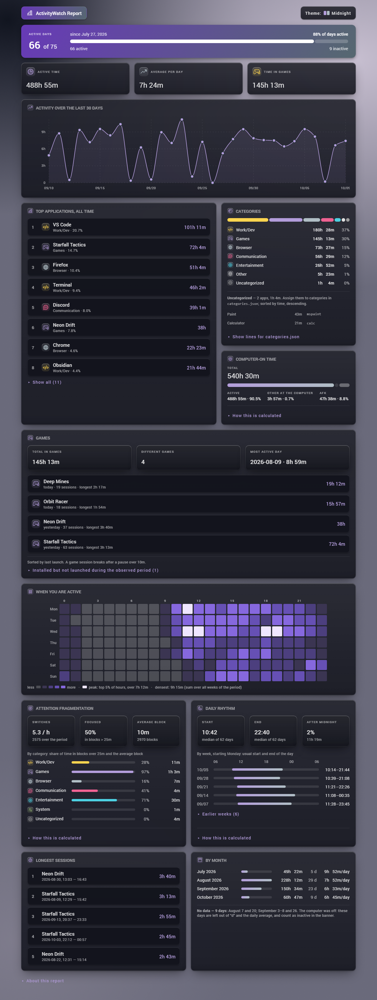

# aw-dashboard

[English](README.md)

Офлайн-звіт по даних [ActivityWatch](https://activitywatch.net/).
Скрипт читає події з локального API ActivityWatch, рахує статистику
і записує **один самодостатній HTML-файл**. Файл відкривається подвійним
кліком і працює без мережі: CSS, графіки, іконки й скрипт усередині,
жодних CDN чи зовнішніх запитів.



*На скриншоті вигадані демо-дані (`python report.py --demo`).*

## Що є у звіті

- **Активні дні.** Дні з активністю з усіх календарних днів від першої
  події.
- **Підсумки.** Активний час, середнє на день і час в іграх.
- **Останні 30 днів.** Активність по днях.
- **Топ програм і категорії.** Категорії задаються у вашому
  `categories.json`.
- **Час з увімкненим ПК.** Розкладено на активний час, інше за
  компʼютером і AFK.
- **Ігри.** Останні запуски, кількість сесій, найдовша сесія, а також
  встановлені ігри, які ще не запускались.
- **Heatmap.** День тижня × година, шкала за квантилями.
- **Фрагментація уваги.** Перемикання на годину, частка часу в глибоких
  блоках (понад 25 хв) і середній блок.
- **Ритм дня.** Медіана початку й кінця дня по тижнях і час після
  опівночі.
- **Найдовші сесії й таблиця по місяцях.**
- **Десять колірних тем.** Три темні, три світлі, три монохромні плюс
  Midnight. Перемикаються без JavaScript.

Усі числа рахує `aw_data.py`. `report.py` лише розставляє їх по
верстці.

## Вимоги

- Python 3.10 або новіший.
- [`requests`](https://pypi.org/project/requests/).
- Запущений ActivityWatch на `http://localhost:5600` з `aw-watcher-window`
  і бажано `aw-watcher-afk`. Без AFK-вотчера час рахується без фільтра
  відсутності, і звіт про це попереджає.
- За бажання: Chrome або Edge, для перевірки верстки в
  `check_layout.py`.

Генерація звіту працює на будь-якій ОС. Ярлик на робочому столі
(`launch.pyw`, `make_shortcut.ps1`) і типові шляхи до бібліотек ігор
у `scan_games.py` розраховані на Windows.

## Встановлення

```bash
git clone <цей репозиторій>
cd aw-dashboard
pip install requests
```

## Запуск

```bash
python report.py                  # зібрати dashboard.html з ваших даних
python report.py --lang en        # те саме з англійським інтерфейсом
python report.py --demo           # вигадані дані → dashboard-demo.html
python report.py --demo --lang en
```

`report.py` друкує шлях до звіту. Браузер він не відкриває.

Інші інструменти:

```bash
python aw_data.py         # текстовий зріз статистики в терміналі, без HTML
python scan_games.py      # знайти встановлені ігри й дописати їх у categories.json
python theme.py           # аудит контрасту всіх тем (WCAG 4.5:1 / 3:1)
python check_layout.py    # перевірка верстки в headless Chrome/Edge на 4 ширинах
python make_icon.py       # перемалювати dashboard.ico
```

### Ярлик на робочому столі (Windows)

```bash
powershell -ExecutionPolicy Bypass -File make_shortcut.ps1 -Name "Звіт ActivityWatch"
```

Команда створює ярлик, який запускає `launch.pyw` через `pythonw.exe`.
Звіт перегенеровується і відкривається в браузері без вікна консолі.
Помилки показуються вікном повідомлення. Без `-Name` ярлик називається
«ActivityWatch Report».

### Архів

Кожен звичайний запуск (не `--demo`) також зберігає
`archive/dashboard-РРРР-ММ-ДД.html`. Повторний запуск того ж дня
перезаписує копію за цей день. Зберігаються лише `ARCHIVE_KEEP` (30)
найновіших копій. `ARCHIVE_KEEP = 0` вимикає архів; наявні копії при
цьому не видаляються.

## Налаштування

### `config.py`

| Параметр | За замовчуванням | Значення |
|---|---|---|
| `LANGUAGE` | `"uk"` | Мова інтерфейсу: `"uk"` або `"en"`. Від неї залежать і формати тривалостей та дат. `--lang` перекриває параметр на один запуск. |
| `DEFAULT_THEME` | `"midnight"` | Тема, яку видно першою. Вибір у меню браузер запамʼятовує. |
| `API` | `http://localhost:5600/api/0` | API ActivityWatch. |
| `GAME_CATEGORY` | `"Ігри"` | Назва категорії в `categories.json`, де лежать ігри. |
| `SYSTEM_PROCESSES` | — | Процеси оболонки, які повністю виключаються зі статистики. |
| `AFK_LENIENT_CAP_SECONDS` | 30 хв | Скільки AFK максимум зараховується категорії `lenient` з кожного AFK-блоку. |
| `SESSION_GAP_SECONDS` | 120 | Пауза, довша за цю, завершує сесію або блок уваги. |
| `GAME_SESSION_GAP_SECONDS` | 600 | Те саме для ігор (завантаження, пошук матчу). |
| `FOCUS_MIN_DWELL_SECONDS` | 10 | Фокус, коротший за цей, — це прохід, а не перемикання. |
| `FOCUS_DEEP_SECONDS` | 25 хв | Блоки, довші за цей, вважаються глибокими. |
| `DAY_START_SECONDS` | 06:00 | Коли починається логічна доба в ритмі дня. |
| `ICON_SHAPE` | `"rounded_square"` | Форма плашок іконок: `circle`, `rounded_square`, `squircle` або `hexagon`. |
| `EMBED_FONT` | `False` | Вшити Roboto з `fonts/` через base64. Інакше використовується системний шрифт. |
| `ARCHIVE_KEEP` | 30 | Скільки денних копій тримати; `0` вимикає архів. |
| `DEMO` | `False` | Завжди брати демо-дані, як із `--demo`. |

Кожен поріг у `config.py` має коментар, чому в нього саме таке значення.

Теми: `midnight`, `indigo-teal`, `deep-purple-amber`, `blue-grey-cyan`,
`indigo-pink`, `teal-deep-orange`, `brown-light-green`, `blue-mono`,
`red-mono`, `blue-red`.

### `categories.json`

Файл розкладає програми по категоріях. Під час першого запуску він
створюється зі стартового набору, а далі ви редагуєте його вручну:

```json
{
  "Ігри": {
    "afk_policy": "strict",
    "processes": ["eldenring", "factorio"],
    "patterns": []
  },
  "Спілкування": {
    "afk_policy": "lenient",
    "processes": ["discord", "zoom", "telegram"],
    "patterns": []
  }
}
```

- **`processes`** — точні імена процесів. Регістр не враховується,
  `.exe` можна не писати.
- **`patterns`** — підрядки в імені процесу. Точне імʼя завжди має
  пріоритет над шаблоном. Якщо збігаються шаблони кількох категорій,
  перемагає та, що вище у файлі, а конфлікт показується у звіті.
- **`afk_policy`** — `strict` або `lenient`.
  - `strict` (за замовчуванням) рахує лише час, коли ви працюєте
    з клавіатурою й мишею.
  - `lenient` додає ще й AFK-час, поки вікно категорії у фокусі, але
    не більше `AFK_LENIENT_CAP_SECONDS` з кожного AFK-блоку. Це для
    дзвінків і відео, де ви слухаєте, нічого не натискаючи.
- **Кольори.** Кольори категорій ідуть за порядком у файлі: перші шість
  категорій отримують шість кольорів категорій теми. Категорії, що
  займають менше 3% часу, зливаються в «Інше».
- **Назви.** Назви категорій — ваші дані, у звіті вони показуються як є.
  Якщо перейменуєте категорію ігор, змініть і `GAME_CATEGORY`
  у `config.py`.

`aw-watcher-window` віддає лише імʼя процесу, без шляху. Тому правило
на кшталт «усе зі `steamapps\common` — гра» до подій застосувати не
можна. `scan_games.py` застосовує його на диску: він сканує бібліотеки
Steam, GOG та Epic (`STEAM_ROOTS`, `GAME_LIBRARY_ROOTS`) і дописує точні
імена exe в категорію ігор. Щоб спершу переглянути зміни, додайте
`--dry-run`.

### Назви програм

Назви для показу замість імен exe (`"code.exe": "VS Code"`) лежать
у `app_names.local.json`, який не потрапляє в git. Для початку скопіюйте
приклад:

```bash
cp app_names.example.json app_names.local.json
```

Поки локального файлу немає, використовується `app_names.example.json`.
Регістр ключів не враховується; кілька exe можуть мати одну назву, тоді
їхній час додається. Назви системних програм Windows (Диспетчер задач
тощо) беруться з розділу `app_names` у `locales/*.json`, тож ідуть
за мовою інтерфейсу. Ваш файл їх перекриває.

### Нова мова

1. Скопіюйте `locales/en.json` у `locales/<код>.json` і перекладіть
   значення. Збережіть `{заповнювачі}` і HTML-теги на кшталт `<b>`
   та `<code>`.
   Сюди входить і розділ `app_names` з назвами системних програм.
2. Якщо в мові більше двох форм множини, додайте правило
   в `PLURAL_RULES` у `i18n.py`, як для української.
3. Задайте `LANGUAGE = "<код>"` або запустіть
   `python report.py --lang <код>`.

## Демо-режим

`python report.py --demo` не звертається до ActivityWatch і не чіпає
`categories.json`:

- **Дані.** `demo.py` з фіксованим зерном генерує події вікон і AFK
  приблизно за десять тижнів, що закінчуються сьогодні. Серед них є дні
  з вимкненим ПК, дзвінки, пізні вечори та ігри.
- **Обробка.** Події проходять через той самий `aw_data.collect_stats`,
  що й справжні дані, тож кожна секція рахується по-справжньому.
  Вигадані лише вхідні дані.
- **Результат.** Записується в `dashboard-demo.html` і в архів ніколи не
  потрапляє. Підвал звіту позначає його як демо.
- **Мова.** Назви категорій ідуть за активною мовою.

Демо-режим знадобиться для скриншотів або щоб спробувати звіт без
ActivityWatch.

## Структура

| Файл | Відповідає за |
|---|---|
| `aw_data.py` | Запити до API ActivityWatch і всі підрахунки. |
| `report.py` | Лише рендер HTML: верстка, SVG-графіки, вбудований скрипт. |
| `i18n.py`, `locales/` | Тексти інтерфейсу, форми множини, формати тривалостей і дат. |
| `demo.py` | Синтетичні дані для демо-режиму. |
| `config.py` | Налаштування й пороги. |
| `app_names.py`, `app_names.example.json` | Назви програм для показу. |
| `categories.py`, `categories.json` | Зберігання категорій, зіставлення, пошук конфліктів. |
| `theme.py` | Палітри (Material Design 2014), глибина, типографіка, аудит контрасту. |
| `icons.py`, `assets/icons/` | Іконки Phosphor duotone, вбудовані в HTML. |
| `fonts.py` | Опційне вшивання Roboto. |
| `archive.py` | Денні копії звіту та їх ротація. |
| `check_layout.py` | Перевірка геометрії верстки в headless-браузері. |
| `scan_games.py` | Сканер бібліотек Steam, GOG та Epic. |
| `launch.pyw`, `make_shortcut.ps1`, `make_icon.py` | Ярлик на робочому столі та його іконка. |

## Приватність

Усе лишається на вашому компʼютері. Звіт — локальний файл, зібраний
з вашої локальної бази ActivityWatch, і при відкритті він не робить
жодних мережевих запитів. Згенеровані звіти, `archive/`,
`categories.json` і `app_names.local.json` описують ваші звички, тому
всі вони в `.gitignore`. Подумайте, перш ніж ними ділитися.

## Ліцензія

[MIT](LICENSE) © 2026 closedude.

## Подяки

- Іконки: [Phosphor Icons](https://phosphoricons.com/), ліцензія MIT.
  Див. [`licenses/phosphor.txt`](licenses/phosphor.txt).
- Кольори: палітри Material Design 2014.
